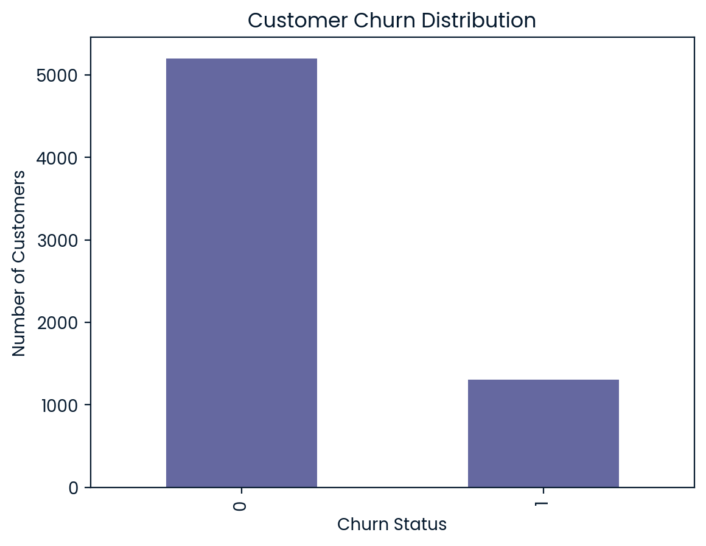

# 1.0 Data Loading and Exploration
## Understand the project objective
Our goal is to predict whether a telecom customer will leave their current telecom provider.

We will compare two classification algorithms:
1. **Logistic Regression**: Predicts the probability of a customer churning.
2. **Random Forest Classifier**: Uses multiple decision trees to make predictions.

Our final objective is to determine which model achieves the higher accuracy score.

Understanding the datasets
| Dataset | Purpose | Records |
|---|---|---|
| `telecom_demographics.csv` | Customer demographic information | To investigate |
| `telecom_usage.csv` | Customer usage patterns and churn status | To investigate |

We will merge them using `customer_id`.

Our final DataFrame will be called `churn_df`.

## 1.1 Import libraries
```python
import pandas as pd
from sklearn.preprocessing import StandardScaler, OneHotEncoder 
from sklearn.model_selection import train_test_split
from sklearn.linear_model import RidgeClassifier
from sklearn.ensemble import RandomForestClassifier
from sklearn.metrics import classification_report, confusion_matrix

from sklearn.linear_model import LogisticRegression
from sklearn.metrics import accuracy_score
```

## 1.2 Load the datasets
```python
# Load the datasets
telecom_demographics = pd.read_csv('telecom_demographics.csv')
telecom_usage = pd.read_csv('telecom_usage.csv')
```

## 1.3 Inspect the datasets
### 1.3.1 Display the first five rows
```python
telecom_demographics.head()
```
Output:
| index | customer_id | telecom_partner | gender | age | state | city | pincode | registration_event | num_dependents | estimated_salary |
|---:|---:|---|---|---:|---|---|---:|---|---:|---:|
| 0 | 15169 | Airtel | F | 26 | Himachal Pradesh | Delhi | 667173 | 2020-03-16 | 4 | 85979 |
| 1 | 149207 | Airtel | F | 74 | Uttarakhand | Hyderabad | 313997 | 2022-01-16 | 0 | 69445 |
| 2 | 148119 | Airtel | F | 54 | Jharkhand | Chennai | 549925 | 2022-01-11 | 2 | 75949 |
| 3 | 187288 | Reliance Jio | M | 29 | Bihar | Hyderabad | 230636 | 2022-07-26 | 3 | 34272 |
| 4 | 14016 | Vodafone | M | 45 | Nagaland | Bangalore | 188036 | 2020-03-11 | 4 | 34157 |

```python
telecom_usage.head()
```
Output:
| index | customer_id | calls_made | sms_sent | data_used | churn |
|---:|---:|---:|---:|---:|---:|
| 0 | 15169 | 75 | 21 | 4532 | 1 |
| 1 | 149207 | 35 | 38 | 723 | 1 |
| 2 | 148119 | 70 | 47 | 4688 | 1 |
| 3 | 187288 | 95 | 32 | 10241 | 1 |
| 4 | 14016 | 66 | 23 | 5246 | 1 |

### 1.3.2 Check the dataset dimensions
```python
print("Demographics shape:", telecom_demographics.shape)
print("Usage shape:", telecom_usage.shape)
```
Output:
```
Demographics shape: (6500, 10)
Usage shape: (6500, 5)
```

### 1.3.3 Inspect column names and data types
```python
telecom_demographics.info()
```
Output:
```
<class 'pandas.core.frame.DataFrame'>
RangeIndex: 6500 entries, 0 to 6499
Data columns (total 10 columns):
 #   Column              Non-Null Count  Dtype 
---  ------              --------------  ----- 
 0   customer_id         6500 non-null   int64 
 1   telecom_partner     6500 non-null   object
 2   gender              6500 non-null   object
 3   age                 6500 non-null   int64 
 4   state               6500 non-null   object
 5   city                6500 non-null   object
 6   pincode             6500 non-null   int64 
 7   registration_event  6500 non-null   object
 8   num_dependents      6500 non-null   int64 
 9   estimated_salary    6500 non-null   int64 
dtypes: int64(5), object(5)
memory usage: 507.9+ KB
```

```python
telecom_usage.info()
```
Output:
```
<class 'pandas.core.frame.DataFrame'>
RangeIndex: 6500 entries, 0 to 6499
Data columns (total 5 columns):
 #   Column       Non-Null Count  Dtype
---  ------       --------------  -----
 0   customer_id  6500 non-null   int64
 1   calls_made   6500 non-null   int64
 2   sms_sent     6500 non-null   int64
 3   data_used    6500 non-null   int64
 4   churn        6500 non-null   int64
dtypes: int64(5)
memory usage: 254.0 KB
```

### 1.3.4 Check missing values
```python
telecom_demographics.isnull().sum()
```
Output:
| Column             | Missing Values |
|--------------------|---------------:|
| index              | 0              |
| customer_id        | 0              |
| telecom_partner    | 0              |
| gender             | 0              |
| age                | 0              |
| state              | 0              |
| city               | 0              |
| pincode            | 0              |
| registration_event | 0              |
| num_dependents     | 0              |
| estimated_salary   | 0              |

```python
telecom_usage.isnull().sum()
```
Output:
| Column       | Missing Values |
|--------------|---------------:|
| index        | 0              |
| customer_id  | 0              |
| calls_made   | 0              |
| sms_sent     | 0              |
| data_used    | 0              |
| churn        | 0              |

### 1.3.5 Check duplicate records
```python
print("Demographics duplicates:", telecom_demographics.duplicated().sum())
print("Usage duplicates:", telecom_usage.duplicated().sum())
```
Output:
```
Demographics duplicates: 0
Usage duplicates: 0
```

## 1.4 Review data exploration findings
### 1.4.1 Dataset overview 

| Inspection | Demographics | Usage |
|---|---:|---:|
| Rows | 6,500 | 6,500 |
| Columns | 10 | 5 |
| Missing values | 0 | 0 |
| Duplicate rows | 0 | 0 |

### 1.4.2 Observations
1. Both datasets contain 6,500 records, suggesting they cover the same number of customers.
2. Both datasets have no missing values.
3. Neither dataset contains duplicate rows.
4. `customer_id` is available in both datasets, so we can use it as the merging key.
5. `registration_event` is currently stored as an object rather than a datetime data type.

**Important**: We should not automatically convert or remove columns without considering the project requirements.

## 1.5 Merge the datasets
The project requires us to merge both datasets into a DataFrame named `churn_df`.

We will use `customer_id` as the common column.

### 1.5.1 Merge using customer_id
```python
# Merge the two datasets 
churn_df = pd.merge(
 telecom_demographics,
 telecom_usage,
 on='customer_id',
 how='inner'
)
```

**Why `how='inner'`?**

An inner join keeps only customers whose `customer_id` exists in both datasets.

Since both datasets contain 6,500 records, we expect the merged dataset to contain 6,500 records, assuming all customer IDs match.

### 1.5.2 Inspect the merged dataset
```python
# Display the first five rows
churn_df.head()
```
Output:
| index | customer_id | telecom_partner | gender | age | state | city | pincode | registration_event | num_dependents | estimated_salary | calls_made | sms_sent | data_used | churn |
|---:|---:|---|---|---:|---|---|---:|---|---:|---:|---:|---:|---:|---:|
| 0 | 15169 | Airtel | F | 26 | Himachal Pradesh | Delhi | 667173 | 2020-03-16 | 4 | 85979 | 75 | 21 | 4532 | 1 |
| 1 | 149207 | Airtel | F | 74 | Uttarakhand | Hyderabad | 313997 | 2022-01-16 | 0 | 69445 | 35 | 38 | 723 | 1 |
| 2 | 148119 | Airtel | F | 54 | Jharkhand | Chennai | 549925 | 2022-01-11 | 2 | 75949 | 70 | 47 | 4688 | 1 |
| 3 | 187288 | Reliance Jio | M | 29 | Bihar | Hyderabad | 230636 | 2022-07-26 | 3 | 34272 | 95 | 32 | 10241 | 1 |
| 4 | 14016 | Vodafone | M | 45 | Nagaland | Bangalore | 188036 | 2020-03-11 | 4 | 34157 | 66 | 23 | 5246 | 1 |

### 1.5.3 Check dimensions
```python
churn_df.shape
```
Output:
```
(6500, 14)
```

### 1.5.4 Check the merged dataset information
```python
churn_df.info()
```
Output:
```
<class 'pandas.core.frame.DataFrame'>
Int64Index: 6500 entries, 0 to 6499
Data columns (total 14 columns):
 #   Column              Non-Null Count  Dtype 
---  ------              --------------  ----- 
 0   customer_id         6500 non-null   int64 
 1   telecom_partner     6500 non-null   object
 2   gender              6500 non-null   object
 3   age                 6500 non-null   int64 
 4   state               6500 non-null   object
 5   city                6500 non-null   object
 6   pincode             6500 non-null   int64 
 7   registration_event  6500 non-null   object
 8   num_dependents      6500 non-null   int64 
 9   estimated_salary    6500 non-null   int64 
 10  calls_made          6500 non-null   int64 
 11  sms_sent            6500 non-null   int64 
 12  data_used           6500 non-null   int64 
 13  churn               6500 non-null   int64 
dtypes: int64(9), object(5)
memory usage: 761.7+ KB
```

### 1.5.5 Verify the merge
```python
# Check whether all customer IDs are unique
churn_df['customer_id'].is_unique
```
Output:
```
True
```

## 1.6 Calculate the proportion of customers who churned
The project specifically asks us to calculate the proportion of customers who have churned.

Our target column is `churn`:
- `1` = Customer churned.
- `0` = Customer did not churn.

### 1.6.1 Count customers in each churn category
```python
churn_df['churn'].value_counts()
```
This tells us how many customers belong to each category.

Output:
| index | churn |
|---:|---:|
| 0 | 5197 |
| 1 | 1303 |

### 1.6.2 Calculate the churn proportion
```python
churn_df['churn'].value_counts(normalize=True)
```
The `normalize=True` argument returns proportions instead of raw counts.

Output:
| index | churn |
|---:|---:|
| 0 | 0.7995384615 |
| 1 | 0.2004615385 |

Alternatively:
```python
churn_df['churn'].mean()
```
This works because churn is a binary variable containing only 0 and 1.
For example, if the result is 0.35, it means 35% of customers have churned.

Output:
```
0.20046153846153847
```

### 1.6.3 Visualize the churn distribution
```python
churn_df['churn'].value_counts().plot(
    kind='bar',
    title='Customer Churn Distribution',
    xlabel='Churn Status',
    ylabel='Number of Customers'
)
```
This helps us understand whether the dataset is balanced or imbalanced.

Output:
```
<AxesSubplot: title={'center': 'Customer Churn Distribution'}, xlabel='Churn Status', ylabel='Number of Customers'>
```



## 1.7 Identify categorical variables
The project also requires us to identify categorical variables in `churn_df`.

Categorical variables represent groups or labels rather than measurable numerical quantities.

Based on the initial dataset inspection, we can identify:
| Variable | Description |
|---|---|
| `telecom_partner` | Telecom provider |
| `gender` | Customer gender |
| `state` | Customer state |
| `city` | Customer city |
| `registration_event` | Registration date |

We can identify these columns programmatically.
```python
# Identify categorical columns
categorical_cols = churn_df.select_dtypes(
    include=['object']
).columns.tolist()

print(categorical_cols)
```
Output:
```
['telecom_partner', 'gender', 'state', 'city', 'registration_event']
```
`registration_event` is currently an object column, so it will appear in this list. We will consider its treatment during preprocessing.

## 1.8 Review findings
### 1.8.1 Merged dataset
| Item | Result |
|---|---:|
| Total customers | 6,500 |
| Total columns | 14 |
| Missing values | 0 |
| Unique customer IDs | True |

The merged dataset contains all 6,500 customers, with no duplicate customer IDs.

### 1.8.2 Churn distribution
| Churn | Customers | Proportion |
|---|---:|---:|
| 0 (Not churned) | 5,197 | 79.95% |
| 1 (Churned) | 1,303 | 20.05% |
| **Total** | **6,500** | **100%** |

Approximately 80% of customers have stayed, while 20% have churned.

**Why does this matter?**

A model could achieve approximately 80% accuracy simply by predicting that every customer will stay.

Therefore, when evaluating our models later, we should also examine the classification report and confusion matrix rather than relying entirely on accuracy.

We will still follow the project's requirement to compare accuracy scores.

### 1.8.3 Categorical variables
```
['telecom_partner', 'gender', 'state', 'city', 'registration_event']
```
* `telecom_partner`, `gender`, `state`, and `city` are categorical features.
* `registration_event` is a date stored as text. It should not automatically be treated as an ordinary category.
